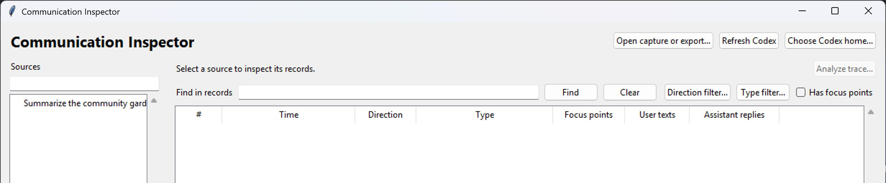
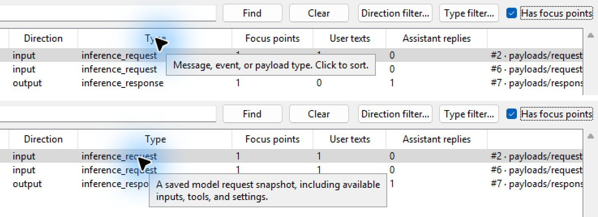
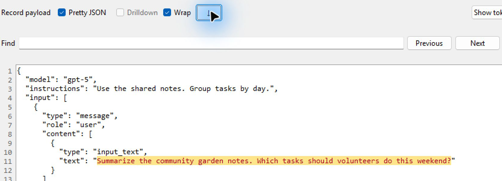
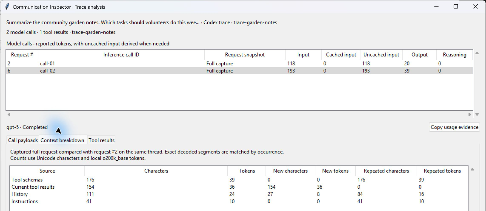
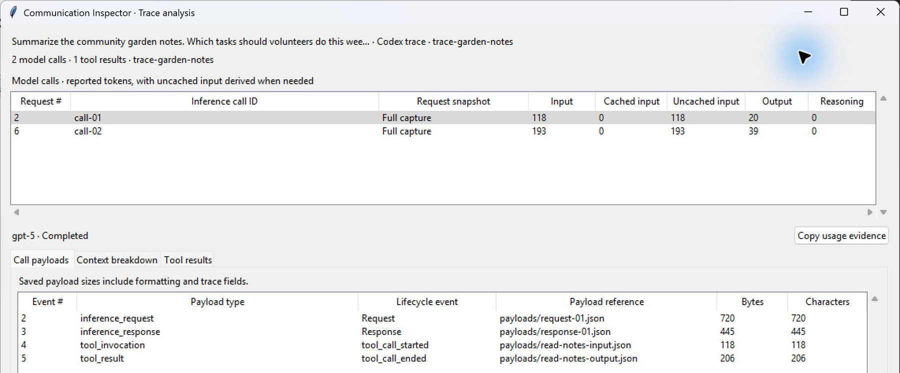
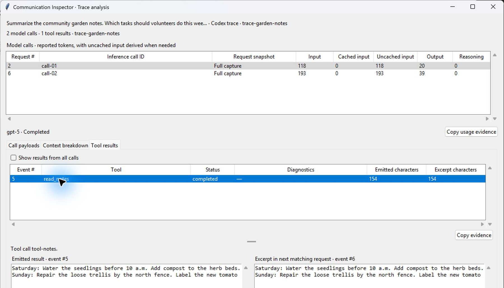

# Communication Inspector

**Skip the slop: [`HUMAN.md`](HUMAN.md)**

A tool for inspecting the communication traces between your Codex GUI app and the models.

Use Python 3.14 or newer with Tkinter. Python 3.14 provides the Zstandard reader needed for compressed Codex logs. Run `python -m tkinter` to check that your Python installation has Tkinter. If it is missing, install Tk support through your Python installer or operating system package manager.

From this directory, run:

```text
python -m pip install -r requirements.txt
python -B inspector.py
```

On Windows you can also double-click [Open Inspector.cmd](Open%20Inspector.cmd) after installing the dependencies. The Python entry point is intended for Windows, macOS, and Linux with a graphical desktop. Windows is the tested platform. The viewer can open existing files without a Codex installation or account.

Select a source on the left, then a record in the timeline. **Find in records** searches the full record text, including nested fields. Use the direction selector to narrow the results. **Pretty JSON** changes the display, and **Copy payload** copies the record before display formatting. Codex JSONL records retain their original text. JSON archives are split into records and reserialized with their fields and values intact.

## Walkthrough

The screenshots use a synthetic Codex trace about community garden notes.

1. Launch Communication Inspector and pick a **Codex trace** from **Sources**.

   

2. Turn on **Has focus points** to keep records that contain user text or assistant replies. Hover over the **Type** heading to learn what the column shows, then hover over a value such as `inference_request` for its definition.

   

3. Select an `inference_request` row with a user text count and click **↓** beside **Wrap**. The payload pane jumps to the original prompt and highlights it.

   

4. Click **Analyze trace…** and select a model call to inspect its token usage and saved payloads. On the second call, open **Context breakdown** to compare new and repeated input with the preceding request.

   

<details>
<summary>Explore call payloads and tool results</summary>

Select the first model call and open **Call payloads** to see the saved request, response, tool invocation, and tool result.



Open **Tool results** and select `read_notes` to compare its emitted output with the excerpt in the next matching request.



</details>

## Codex sessions on this computer

### Token view

**Raw text tokens** counts the saved record as text, including its JSON fields and formatting. **Reported tokens** shows an explicit usage total, or the sum of reported input and output counts when available. Some rows describe the same model call, so adding rows can double-count usage.

**Show tokenization** colors the text currently displayed. Pretty JSON changes that text and can change the count. The inspector uses `tiktoken` with the recorded model when recognized and `o200k_base` otherwise. A Unicode character that spans tokens takes the color of the token that completes it. These local counts describe the inspected text. The service separately accounts for model framing, modalities, caching, and hidden reasoning.

On first use, the tokenizer may download and cache the public vocabulary. Tokenizing a record runs locally and does not upload its contents.

The app discovers persisted sessions under `%USERPROFILE%\.codex\sessions` and `%USERPROFILE%\.codex\archived_sessions`, or uses the `CODEX_HOME` environment variable if set. **Choose Codex home** lets you point to another installation. Click **Refresh Codex** after a turn finishes to read new sessions or reload the selected one. You can also open a standalone `.jsonl` or `.jsonl.zst` rollout. [Codex log locations](https://learn.chatgpt.com/docs/reference/troubleshooting#feedback-and-logs)

Rollouts can include instructions, user and developer messages, tool calls and results, assistant messages, reasoning summaries, and usage. Input and output labels reflect the recorded roles. Retention and compaction affect what you can see, and a rollout cannot establish the exact request sent to the provider at every model call.

### Detailed traces for new local runs

To enable trace capture, set `CODEX_ROLLOUT_TRACE_ROOT` to a directory outside the project. On Windows, run this in PowerShell before starting the Codex CLI:

```powershell
$env:CODEX_ROLLOUT_TRACE_ROOT = Join-Path $env:USERPROFILE '.codex\communication-inspector-traces'
```

To enable capture in the desktop app and future terminals, save the setting for your Windows user, then fully quit and reopen Codex and any terminals that run it.

```powershell
[Environment]::SetEnvironmentVariable('CODEX_ROLLOUT_TRACE_ROOT', $env:CODEX_ROLLOUT_TRACE_ROOT, 'User')
```

After a local turn, click **Refresh Codex** and look for **Codex trace**. Select `inference_request` for the request snapshot, including input items, tool definitions, and request settings. Select `inference_response` for response data when recorded. The timeline also lists lifecycle events and other saved payloads. To inspect a trace from another machine, keep the trace folder intact and open its `manifest.json` or `trace.jsonl`.

This experimental recorder runs inside Codex. It records application-level snapshots and events, with coverage varying by build and execution mode. It cannot recover traces from before capture was enabled. Codex writes these files locally even when the inspector is closed. To stop future recording, run the following and restart the relevant Codex processes. Existing files remain in the trace directory.

```powershell
[Environment]::SetEnvironmentVariable('CODEX_ROLLOUT_TRACE_ROOT', $null, 'User')
Remove-Item Env:CODEX_ROLLOUT_TRACE_ROOT -ErrorAction SilentlyContinue
```

### Analyze a trace

Select a **Codex trace**, then click **Analyze trace…**. Select a model call in the upper table to see its request, response and tool payloads together.

- **Model calls** shows reported input, cached input, uncached input, output and reasoning tokens. Uncached input is calculated from reported input and cached input when available. Reasoning can be included in reported output. A delta references a previous response.
- **Call payloads** shows the saved byte and character counts with the event sequence and sidecar path. Duplicate lifecycle copies are collapsed here. The original records are available in the timeline.
- **Context breakdown** ranks decoded segments by source and compares them with the preceding captured request on the same thread. A segment counts as repeated if a matching occurrence was present in that request. Local token estimates are summed over individual segments, with tool definitions measured as compact JSON. A delta breakdown covers the fields saved in the delta. Opaque and encoded fields have their own row.
- **Tool results** flags possible broad searches, truncation, lines of 3,000 characters or more, and similar retries after failure. Select a result to compare the recorded output with the first later captured request carrying a matching tool call ID. Nested tools can show the enclosing code cell's excerpt. Enable **Show results from all calls** to see results without an identified owner as well.

Use **Copy evidence** on a selected row or **Copy usage evidence** on a model call to copy a Markdown table with trace ID, event sequence, sidecar path, count method and counts. Comparison rows also identify the related payload when available.

For a compact local audit, pass the trace directory, its `manifest.json` or its `trace.jsonl` to the command below. Findings are drawn from tool flags, decoded context, reported usage and saved request sizes. The output contains references and counts. Use `--tokens` to add local token estimates for decoded context.

```text
python -B trace_audit.py "path/to/trace-directory" --limit 10
```

## ChatGPT on the web

For new browser traffic in Chrome or Edge:

1. In the ChatGPT tab, open Developer Tools with `Ctrl+Shift+I` and select **Network**.
2. Make sure recording is on. Turn on **Preserve log** if you will navigate or reload. Clear any unrelated traffic before starting the chat.
3. Send your prompt. After the response finishes, export a **sanitized HAR** from the Network panel.
4. In the inspector, choose **Open capture or export…** and open the `.har`. Select an exchange to inspect its request, response, and other captured fields.

HAR covers the browser’s network exchange during recording. It can omit stream bodies, WebSocket frames, and other data the browser did not export. You can view available stream events or WebSocket messages in the browser’s Network panel. Sanitization removes common credential headers. The bodies can still contain private prompts, responses, and attachments. [Chrome Network panel reference](https://developer.chrome.com/docs/devtools/network/reference/#export-requests-data)

For past chats, where account export is available, go to **Settings → Data Controls → Export Data** in ChatGPT. Open the resulting ZIP or an extracted `conversations*.json` file. The inspector includes alternate branches present in the export. Exported conversation records show what the export retained.

## Preview local Codex prompt construction

In PowerShell, from this folder:

```powershell
python preview.py --workspace 'C:\path\to\project' --output 'prompt-preview.json' --prompt 'Your prompt'
```

Open `prompt-preview.json` in the inspector. The preview uses your installed CLI to construct the input list for the selected workspace. It covers a new local prompt and does not run a model turn. You can omit `--prompt` to inspect the default input list. [Codex prompt-input reference](https://learn.chatgpt.com/docs/cli/reference#codex-debug-prompt-input)

## Coverage and storage

Server-side context and hosted tool actions can remain inside OpenAI’s systems. The Responses API exposes reasoning summaries on supported models and can return opaque encrypted reasoning state. Raw private reasoning is unavailable. [Hosted execution visibility](https://learn.chatgpt.com/docs/enterprise/chatgpt-work-cloud-security#audit-and-compliance-visibility) · [Reasoning visibility](https://developers.openai.com/api/docs/guides/reasoning#reasoning-summaries)

The inspector reads the original files in place and displays records in memory. It makes no network requests and creates no archive of what you open. Store exported files somewhere suitable for the data they contain.

The inspector also accepts saved API request or response JSON, input-item lists, and `.sse` event streams. Capture or save these in the API client that makes the request, then open the file. [Responses API input items](https://developers.openai.com/api/reference/resources/responses/subresources/input_items/methods/list)
